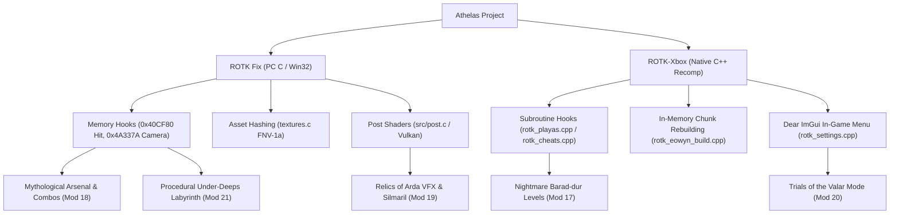

# The Lord of the Rings: The Return of the King — Modding Roadmap & Ideas
*Tailored for the Athelas Launcher, ROTK Fix (PC), and the Native Xbox PC Port*

---

## 1. Executive Summary & Engine Context

### 1.1 The Game
*The Lord of the Rings: The Return of the King* (EA Redwood Shores, 2003) is an iconic hack-and-slash action adventure based on Peter Jackson's film trilogy. Key mechanics include:
- **Combat Mechanics:** Speed Attack, Fierce Attack, Physical Attack (Knock-back/Shield break), Parry/Block, Projectile (Bow/Throwing Dagger/Staff blast), and Killing Moves (downed finishers).
- **Battle Rating & Perfect Mode:** Combo variety and kill momentum scale combat performance from *Fair* to *Good*, *Excellent*, and *Perfect*. In *Perfect Mode*, attacks inflict double damage and score bonus experience.
- **Three Campaign Paths:** Path of the Wizard (Gandalf), Path of the King (Aragorn, Legolas, Gimli), and Path of the Hobbits (Frodo, Sam).
- **Arenas & Secrets:** Palantir of Saruman and Palantir of Sauron (20 survival waves), unlockable heroes (Faramir, Merry, Pippin), and cheat toggles.

### 1.2 Athelas Project Architecture
Athelas provides two execution environments for *The Return of the King*:
1. **ROTK Fix (PC - Win32):**
   - Intercepts Direct3D 8 (`d3d8.dll`) and DirectInput 8 (`dinput8.dll`) using proxy DLLs.
   - Graphics rendered via DXVK (Vulkan backend) or native D3D8, input through SDL3, audio through DSOAL/OpenAL Soft.
   - Live memory patching (`src/gameplay.c`, `src/achieve.c`, `src/graphics.c`, `src/input.c`, `src/textures.c`).
   - Texture dumping and replacement system using FNV-1a 64-bit hashing (`ROTKFix\textures\dump\` & `replace\`).
2. **ROTK-Xbox (Native PC Port):**
   - Static binary recompilation via `XboxXBE-Recomp` generating native x86_64 Direct3D 12 code.
   - Deep hook system (`ports/rotk-xbox/rotkxbox/src/game/`): `rotk_eowyn_build.cpp` (runtime SHOC chunk `.scx` file rebuilding), `rotk_playas.cpp` (character & level overrides), `rotk_cheats.cpp`, `rotk_scx.cpp`.
3. **Data Formats:**
   - Level & Character containers: `.scw` (PC) / `.scx` (Xbox) using chunked SHOC structures (`COHS`, `RDHS`, `TADS`, `tadR`) with proprietary LZ compression.
   - Video containers: `.avi` (DivX 5) on PC, `.vid` chunked DivX container on Xbox.

---

## 2. Mod Ideas Master Index

| # | Mod Name | Category | Primary Target | Difficulty |
|---|---|---|---|---|
| **1** | **Endless Palantir Rogue-Lite** | Game Mode | PC & Xbox Port | Medium-High |
| **2** | **Full Unrestricted Campaign Co-op** | Multiplayer / Co-op | PC & Xbox Port | Low-Medium |
| **3** | **Playable Bosses & Villains (Éowyn Framework)** | Character Roster | Xbox Port & PC | High |
| **4** | **Hardcore Combat Overhaul ("Mayhem Mode")** | Combat / Gameplay | PC & Xbox Port | Medium |
| **5** | **Tolkien Boss Rush & Survival Gauntlet** | Game Mode | PC & Xbox Port | Medium |
| **6** | **Modern RPG Dynamic HUD & Damage Numbers** | UI / Quality of Life | PC (ROTK Fix) | Medium |
| **7** | **AI 4K Texture Pack & Material Overhaul** | Graphics / Assets | PC & Xbox Port | Low-Medium |
| **8** | **Restored Content: Developer Debug Menu** | Engine / Secrets | PC & Xbox Port | Low |
| **9** | **Modern Over-the-Shoulder (TPS) Action Camera** | Camera / Controls | PC & Xbox Port | High |
| **10** | **PvP Fellowship Duel & Versus Arena Mode** | Multiplayer / PvP | PC & Xbox Port | Medium |
| **11** | **Endless Siege of Minas Tirith (Defense Mode)** | Game Mode | PC & Xbox Port | Medium-High |
| **12** | **"Fellowship Iron Man" Permadeath & Injury Campaign** | Metagame / Hardcore | PC & Xbox Port | Medium |
| **13** | **Weapon Switching & Tactical Combat Stances** | Combat / Progression | PC & Xbox Port | Medium-High |
| **14** | **Dynamic Lossless Film OST & Soundscape Overhaul** | Audio / Atmosphere | PC (ROTK Fix) | Medium |
| **15** | **Speedrun & Practice Suite (Savestates & Hitboxes)** | Tooling / Quality of Life | PC & Xbox Port | Medium |
| **16** | **Gloom of Mordor & Atmospheric Shader Suite** | Graphics / Shaders | PC (DXVK / D3D) | Low-Medium |
| **17** | **"The Scouring & Fall of Barad-dûr" Nightmare Levels** | Endgame Levels | PC & Xbox Port | High |
| **18** | **"Weapons of the First Age" Mythological Super Combos** | Weapons & Combat | PC & Xbox Port | Medium-High |
| **19** | **"Relics of Arda" Silmarils, Rings of Power & Legendary Armor** | Lore Artifacts & VFX | PC & Xbox Port | Medium-High |
| **20** | **"Trials of the Valar" (Mythological Roguelike Mode)** | Roguelike & Menu Mode | PC & Xbox Port | High |
| **21** | **"The Under-Deeps of Arda" (Procedural Labyrinth & Biomes)** | Procedural Dungeon | PC & Xbox Port | Very High |

---

## 3. Core Mod Specifications & Blueprints (Mods 1 to 8)

### Mod 1: Endless Palantir Rogue-Lite Mode
- **Concept:** Transform the 20-wave Palantir arenas (`pal01`, `pal02`) into an infinite survival mode with perk card choices every 5 waves.
- **Implementation:** Intercept wave progression in `pal01`/`pal02`; cancel the level victory trigger at wave 20; reset wave counter with scaling difficulty multipliers; render interactive perk selection UI via Dear ImGui in `ports/rotk-xbox` or overlay in `src/post.c`.
- **AI Prompt:**
  ```markdown
  I want to implement an Endless Rogue-Lite mode for the Palantir Arenas in Athelas (ROTK Fix / ROTK Xbox port).
  In ROTK, levels pal01 and pal02 spawn 20 fixed waves of enemies.
  ROTK Fix hooks hit damage at 0x40CF80 (src/gameplay.c) and renders post overlays via src/post.c.
  The Xbox port has Dear ImGui integrated (rotk_settings.cpp).
  Please implement:
  1. A wave detector that identifies when active level is pal01 or pal02.
  2. A hook that prevents the level end victory trigger at wave 20 and loops the wave counter with a difficulty scale multiplier (+15% enemy HP/damage per loop).
  3. A perk selection popup menu using ImGui after every 5 waves offering 3 perks.
  4. Memory modifiers applying selected perks to the player object ([0x17F758]).
  ```

---

### Mod 2: Full Unrestricted Campaign Co-op
- **Concept:** Enable 2-Player Co-op across all 13 levels, including solo-restricted levels (Helm's Deep, Escape from Osgiliath, Shelob's Lair, and Crack of Doom).
- **Implementation:** In `ports/rotk-xbox/rotkxbox/src/game/rotk_playas.cpp` and `src/gameplay.c`, lift the `!(coop && level >= 9)` restriction in `sub_0009E870` / `hook_heroes`. Hook scene loading (`0x9C100`) to spawn Player 2 near Player 1 with a fallback offset if no native P2 spawn exists.
- **AI Prompt:**
  ```markdown
  I want to unlock full 2-player co-op for all campaign levels in Athelas.
  In rotk_playas.cpp (sub_0009E870), remove the restriction `!(coop && level >= 9)` so levels 9 (Osgiliath), 10 (Shelob), 11 (Cirith Ungol), and 12 (Crack of Doom) can be selected in co-op.
  Update src/gameplay.c to match. In the scene loader hook (0x9C100), ensure Player 2's character model and controls are initialized properly even on solo-scripted levels, setting P2 spawn at P1 position + 50 units.
  ```

---

### Mod 3: Playable Bosses & Villains (The Éowyn Framework Extended)
- **Concept:** Extend the dynamic runtime asset injection framework demonstrated in `rotk_eowyn_build.cpp` to make bosses and NPC allies playable (e.g. Witch-king of Angmar, Ringwraith, Boromir, Uruk Berserker).
- **Implementation:** Read target models and textures from `.scw`/`.scx` SHOC chunks (`COHS`, `RDHS`); dynamically build character containers in RAM; serve them via `kernel::SetFileProvider` to replace player files (`Char_*.scx`); replace HUD portrait in `GlobScen.scx`.
- **AI Prompt:**
  ```markdown
  Extend the Éowyn injection system in ports/rotk-xbox/rotkxbox/src/game/rotk_eowyn_build.cpp to create a new playable character mod: Play as the Witch-king of Angmar over Aragorn (Char_Ara.scx).
  Read the Witch-king mesh and textures from Pelennor Fields (Data\Game\pel\pel02.scx); rebuild Char_Ara.scx and Foll_Ara.scx in memory; inject his portrait into GlobScen.scx; and hook rotk_lang.cpp to display "Witch-king of Angmar".
  ```

---

### Mod 4: Hardcore Combat Overhaul ("Mayhem Mode")
- **Concept:** Revamp combat pacing: increase simultaneous attacking enemies cap from 2 to 6-8, add 100ms Perfect Parry counter-attacks, and allow rolling/evading to cancel Fierce Attack recovery.
- **Implementation:** Patch combat AI attack token limits near `0x40CF80` and `0x4BE6E0`; add timing check to parry blocks; interrupt attack recovery frames upon roll button press in `input.c`.
- **AI Prompt:**
  ```markdown
  In src/gameplay.c, modify the hit hook at 0x40CF80 to add a 100ms Perfect Parry window that negates incoming damage, staggers the attacker, and triggers an execution counter-attack.
  Add an INI setting [Combat] EnemyAggression=200 to increase attacking frequency, and hook player state updates in src/input.c to allow dodge rolls to cancel fierce attack recovery animations.
  ```

---

### Mod 5: Tolkien Boss Rush & Survival Gauntlet
- **Concept:** Sequentially fight King of the Dead (`pat03`), Shelob (`she01`), Witch-king (`pel02`), and Gollum (`cra01`) with persistent HP and arrow counts.
- **Implementation:** In `rotk_harness_level.cpp` or `src/gameplay.c`, intercept boss death triggers to write the next boss level index into level target address (`0x16D554`), serializing HP (`+0x90`) and ammunition across transitions.
- **AI Prompt:**
  ```markdown
  Implement a Boss Rush mode in Athelas sequencing levels pat03, she01, pel02, and cra01.
  When a boss dies, intercept level exit and load the next boss level via 0x16D554 (Xbox) / 0x9C090, carrying over current player HP (+0x90) and missile counts. Draw an active timer and current boss index via ImGui.
  ```

---

### Mod 6: Modern RPG Dynamic HUD & Damage Numbers
- **Concept:** Auto-fade HUD outside of combat; render floating RPG combat text (damage numbers) above hit targets with 3D-to-screen projection.
- **Implementation:** In `src/graphics.c`, modulate alpha on HUD 2D draws (FVF `0x142`) when out of combat; in `hook_hit`, capture 3D enemy world coordinates, project via camera matrix (`0x4A337A`), and render floating numbers in `src/post.c`.
- **AI Prompt:**
  ```markdown
  Implement floating damage numbers in ROTK Fix.
  In src/gameplay.c, capture enemy world position and damage dealt in hook_hit.
  Project coordinates to screen space using the projection matrix at 0x4A337A (see docs/ROTK-ENGINE-NOTES.md).
  Render ascending, fading floating numbers in src/post.c. In src/graphics.c, fade out the 2D HUD if no combat hit has occurred for 4 seconds.
  ```

---

### Mod 7: AI 4K Texture Pack & Material Overhaul
- **Concept:** Upscale all environmental, character, and UI textures to 4K using ESRGAN while preserving original 16-character FNV-1a hashes.
- **Implementation:** Python automation script monitoring `ROTKFix\textures\dump\`, running batch ESRGAN upscales with alpha preservation, and outputting to `ROTKFix\textures\replace\`.
- **AI Prompt:**
  ```markdown
  Write a Python automation script `tools/texture_upscale_pipeline.py`.
  Scan `ROTKFix/textures/dump/<w>x<h>_<hash>.png`. For any unhandled texture, upscale 4x using Real-ESRGAN CLI while preserving alpha cutouts (ALPHAREF=2), and write to `ROTKFix/textures/replace/` preserving the trailing 16 hex characters.
  ```

---

### Mod 8: Restored Content: Developer Debug Menu & Unused Cheats
- **Concept:** Restore the cut developer debug menu hidden behind subroutine `0x4F6F90`, enabling free camera, debug Cheats screen, and level selection hotkeys.
- **Implementation:** NOP out the button-hiding check at `0x4F6F90`; bind `VK_F11` in `input.c` to toggle developer mode byte at `0x8E5780`.
- **AI Prompt:**
  ```markdown
  Restore the cut developer debug menu in ROTK Fix (PC).
  Patch function 0x4F6F90 in src/gameplay.c so debug buttons remain visible on menu screens.
  Hook key F11 in src/input.c to toggle the developer flag at 0x8E5780. Expose an option "Enable Developer Debug Menu" in Athelas launcher settings.
  ```

---

## 4. Advanced Mod Blueprints (Mods 9 to 16)

---

### Mod 9: Modern Over-The-Shoulder (TPS) Dynamic Camera
- **Concept:** Convert fixed cinematic cameras into a modern third-person action camera with 360-degree free-look controlled via mouse or right gamepad thumbstick.
- **Implementation:** Intercept view matrix generation at `0x4A3200` / `0x4A337A`; calculate camera eye position relative to player coordinates `[0x17F758] + 0x30` using mouse yaw/pitch angles; perform raycast bounds checking against terrain chunks (`ter`).
- **AI Prompt:**
  ```markdown
  I want to implement a Modern Over-The-Shoulder Camera mod for ROTK Fix (PC) in Athelas.
  Camera projection matrix hook: 0x4A337A (docs/ROTK-ENGINE-NOTES.md).
  Gameplay camera view matrix is built in 0x4A3200.
  Player world position is stored at [0x17F758] + 0x30 (X, Y, Z floats).
  Mouse delta is already polled in `src/input.c`.
  Please implement an INI toggle `[Camera] ModernTPSCamera = 1` and write a hook calculating an over-the-shoulder camera view matrix based on player coordinates and mouse yaw/pitch angles.
  ```

---

### Mod 10: PvP Fellowship Duel & Versus Arena Mode
- **Concept:** Turn the co-op engine into a 1v1 fighting game (Best 2-of-3 rounds) with friendly fire, player-vs-player parrying, and arena select.
- **Implementation:** In `src/gameplay.c`, allow `hook_hit` to process hits when both `is_player(who)` and `is_player(by)` are true; enable parry counter staggers between players; track round wins and coordinate resets in RAM.
- **AI Prompt:**
  ```markdown
  Build a 2-Player Versus / PvP Duel Mode in Athelas (ROTK Fix / ROTK Xbox port).
  Co-op already supports two local pads (Player 1 at [0x17F758], Player 2 at [0x17F75C]).
  In `src/gameplay.c`, add `[Gameplay] PvPMode = 1`. When active, process hits where both `is_player(who)` and `is_player(by)` are true. Ensure parries stagger human opponents, and implement an ImGui round manager for First to 3 Kills.
  ```

---

### Mod 11: Endless Siege of Minas Tirith (Defense Mode)
- **Concept:** Transform *Top of the Wall* (`min00`) into an endless siege defense mode with barricades, boiling oil, continuous siege towers, and a Gondorian soldier morale meter.
- **Implementation:** Intercept the wall defense completion event in `min00.scw`/`min00.scx`; loop ladder and siege tower spawning functions; draw a real-time Gondor Morale gauge via Dear ImGui in `src/post.c`.
- **AI Prompt:**
  ```markdown
  Build an Endless Siege of Minas Tirith mode for level `min00` (Top of the Wall) in Athelas.
  Prevent the final cutscene trigger when the wall defense ends.
  Implement an enemy wave re-arm loop: whenever enemy count drops below 4, re-trigger the ladder and siege tower spawning scripts. Render a "Gondor Morale" meter in post.c that fluctuates with living enemies on the wall.
  ```

---

### Mod 12: "Fellowship Iron Man" Permadeath & Injury Campaign
- **Concept:** True permadeath across the campaign: when a hero falls in a mission, they are dead for good on that save file. Remaining levels must be completed with alternate surviving heroes.
- **Implementation:** Hook player death state in `src/gameplay.c`; record fallen hero index (`0..8`) in an `ironman.ini` bitmask; update `hook_heroes` / `rotk_playas.cpp` to return `0` (unselectable) for dead heroes.
- **AI Prompt:**
  ```markdown
  Implement a "Fellowship Iron Man" (Permadeath Campaign) mod in Athelas.
  In `src/gameplay.c`, detect player death and write the hero index to a bitmask in `ROTKFix\ironman.ini`.
  Modify `hook_heroes` in `src/gameplay.c` and `rotk_playas.cpp` so fallen heroes cannot be selected for any future mission. Show an ImGui memorial screen of fallen Fellowship members.
  ```

---

### Mod 13: Weapon Switching & Tactical Combat Stances
- **Concept:** Real-time stance switching (e.g. Aragorn Heavy Two-Handed vs Spear & Shield; Legolas Melee Daggers vs Sniper Bow; Gandalf Glamdring Blade vs Light Staff).
- **Implementation:** Add stance toggle hotkey in `src/input.c`; swap weapon sub-mesh visibility on bone `Bip01 R Hand`; scale damage and attack animation speeds dynamically in `hook_hit_scaled` and `0x4BE6E0`.
- **AI Prompt:**
  ```markdown
  Implement a Tactical Weapon Stance mod for Aragorn and Legolas in ROTK Fix.
  Add a keybind in `src/input.c` that toggles between "Power Stance" and "Speed Stance".
  In `hook_hit_scaled`, scale damage and stagger based on active stance. Dynamically adjust attack animation speed scalars in `0x4BE6E0` based on active stance, and draw a stance indicator on the HUD.
  ```

---

### Mod 14: Dynamic Lossless Film OST & Soundscape Overhaul
- **Concept:** Replace compressed 2003 music with uncompressed Howard Shore orchestral recordings that dynamically crossfade based on Battle Rating intensity.
- **Implementation:** Embed `miniaudio` in `src/sound.c`; stream modern `.flac`/`.ogg` tracks per level; poll Battle Rating flags in `[0x17F758] + 0x634` to crossfade volume stems between ambient and battle intensity.
- **AI Prompt:**
  ```markdown
  Implement a Dynamic High-Fidelity Music Replacer in ROTK Fix (PC).
  In `src/sound.c`, integrate miniaudio to stream `.ogg`/`.flac` files from `ROTKFix/audio/music/`.
  Listen for level changes to trigger corresponding tracks (e.g. pel02 -> RideOfTheRohirrim.ogg), and dynamically crossfade stems according to the player's current Battle Rating (Fair to Perfect).
  ```

---

### Mod 15: Speedrun & Practice Tooling Suite (Savestates & Hitboxes)
- **Concept:** RAM savestates on `F5`/`F6`, live speedrun split timer, frame freeze on `F7`, and 3D wireframe bounding box / hitbox viewer.
- **Implementation:** On `F5`, copy player struct `[0x17F758]` and camera state into a static buffer; restore on `F6`; render OSD timer and 3D bounding boxes via D3D/DXVK line primitives in `src/post.c`.
- **AI Prompt:**
  ```markdown
  Create a Speedrun & Practice Tool for ROTK Fix in Athelas.
  On F5, snapshot the player struct at `[0x17F758]` into memory; on F6, restore player position and health.
  In `src/post.c`, display player world coordinates (X, Y, Z), velocity, and level timer. Render 3D wireframe boxes around weapon hitboxes and enemy hurtboxes.
  ```

---

### Mod 16: Gloom of Mordor & Atmospheric Shader Suite
- **Concept:** 35mm film grain, dynamic torchlight bloom, and atmospheric LUT color grading (oppressive crimson skies and ash in Mordor).
- **Implementation:** Inject 3D LUT texture lookups and compute bloom shaders into the Vulkan post-processing pipeline in `src/shaders/` and `src/post.c`, selected per-level.
- **AI Prompt:**
  ```markdown
  Add an Atmospheric Post-Processing Shader Suite to ROTK Fix (PC).
  In `src/post.c`, apply a 3D LUT shader pass for cinematic color grading.
  Automatically switch profiles based on active level (pel02 -> golden dawn; she01 -> cave desaturation; cra01 -> Mordor crimson). Add configurable sliders in `ROTKFix.ini` for Bloom, Film Grain, and Vignette.
  ```

---

## 5. Mythological Arsenal, Relics of Arda & Nightmare Endgame Levels (Mods 17 to 21)

---

### Mod 17: "The Scouring & Fall of Barad-dûr" — Mythic Nightmare Endgame Levels

#### Concept & Gameplay
Vanilla *Return of the King* concludes with *The Crack of Doom* and *The Black Gate*. For high-skill players who have fully upgraded every hero to Level 10, this mod adds an **Endgame Nightmare Level Suite** featuring punishing difficulty, elite enemy modifiers, environmental hazards, and multi-boss encounters:
1. **Level 14: The Fall of Barad-dûr (Heart of the Dark Tower):**
   - Set in the crumbling inner sanctum of Barad-dûr as Mount Doom erupts.
   - **Encounter:** Fight through waves of Morgul Black Uruks, Olog-hai Great Trolls, and a multi-boss confrontation against **two flying Nazgûl and the Avatar / Shadow of Sauron** wielding the Great Mace of the Second Age.
   - **Hazards:** Erupting magma vents, crumbling floors that break apart if players remain stationary for too long, and toxic Mordor miasma that steadily drains player health unless enemies are killed in Perfect Mode.
2. **Level 15: The Scouring of the Shire (Bywater Reclaimed):**
   - Book-accurate final chapter of Tolkien's epic omitted from the film.
   - Hobbits return home to find the Shire enslaved by "Sharkey" (Saruman) and his band of Ruffians.
   - High-difficulty urban skirmish: burning Hobbit holes, barricades, Ruffian sharpshooters with poison arrows, and a climatic showdown with Saruman and Gríma Wormtongue in the center of Hobbiton.
3. **Level 16: Assault on Dol Guldur:**
   - Assaulting the Necromancer's fortress in Mirkwood alongside the Elves of Lórien, featuring swarms of giant spiders, sorcerous specters, and Khamûl the Easterling.

#### Technical Implementation
1. **Level Table Extension & Map Progression:**
   - In `src/achieve.c` and `rotk_playas.cpp`, expand the level index table (`k_levels`) past index 12 to 15. Expand the progress bitmask `kAllLevels` from `0x1FFF` to `0xFFFF`.
   - On PC, hook the level load address (`0x9C090` / `0x16D554`) to redirect requests for Level 14/15 to customized scene data containers (`Data\Game\bar\bar01.scw` and `Data\Game\shi\shi01.scw`).
2. **Geometry Stitching & Skybox Injection:**
   - Construct new level containers using existing terrain chunks (`ter`) from `cra01.scw` (for Barad-dûr) and `Fro03.scw` / `hel01.scw` (for the Shire), modified via `tools/scw_read.py` and repacked with proprietary LZ compression.
   - Swap the environment skybox textures for dark churning volcanic skies with lightning and burning embers.
3. **Multi-Boss Spawner Queue:**
   - In `rotk_scx.cpp` and `gameplay.c`, hook the level spawner queue: allow spawning multiple boss entity pointers simultaneously (e.g. allocating 2 concurrent Nazgûl controller structs instead of the vanilla single-boss lock).
4. **Nightmare Enemy AI Multipliers:**
   - In `src/gameplay.c`, inject a level-specific scalar: enemies in levels 14–16 gain +300% HP, cannot be interrupted during Fierce attacks (hyper-armor), and their unblockable attacks trigger with 30% faster animation speeds.

#### How to Ask an AI Assistant to Implement This
```markdown
I want to implement a custom Endgame Nightmare Level mod for ROTK Fix and ROTK Xbox port in Athelas.

Architecture Reference:
- Level list is defined in `src/achieve.c` (k_levels array, 13 levels, bitmask 0x1FFF).
- Level selection subroutine: 0x9E870 (Xbox) / 0x482530 (PC). Target level address: 0x16D554.
- Scene files are in `Data\Game\<lvl>\<lvl>NN.scw` (PC) / `.scx` (Xbox) using SHOC chunks (see docs/ROTK-ENGINE-NOTES.md).

Please implement:
1. An expansion to the level table in `src/achieve.c` and `rotk_playas.cpp` adding Level 14 ("The Fall of Barad-dur") and Level 15 ("The Scouring of the Shire"), updating the completion bitmask to 0x7FFF.
2. A scene loader hook redirecting Level 14 to load custom stitched terrain chunks based on `cra01.scw`.
3. A multi-boss spawner patch: allow concurrent spawning of 2 Nazgûl and 3 Trolls in the active scene entity table.
4. Nightmare difficulty modifiers: +300% enemy HP, poise armor on heavy orcs, and a periodic environmental floor-hazard damage tick in `gameplay.c`.
```

---

### Mod 18: "Weapons of the First Age" — Mythological Super Combos & Elemental VFX

#### Concept & Gameplay
Introduce the legendary mythological armaments of Tolkien's First and Second Ages into the game, complete with bespoke combo chains, screen shakes, dynamic audio, and elemental visual effects:

1. **Andúril, The Flame of the West (Reforged Narsil):**
   - *Atmosphere & VFX:* Blazes with a brilliant solar flame aura tracing every sword swing.
   - *Super Combo (Speed, Speed, Fierce, Fierce): "Wrath of the Dúnedain"* — Aragorn leaps into the air and plunges Andúril into the earth; a radial ring of holy solar fire incinerates lesser orcs, while spectral Oathbreakers materialize in a vortex, slicing through all enemies across a 25-meter radius.
2. **Glamdring, The Foe-Hammer (Turgon's Blade):**
   - *Atmosphere & VFX:* Glows bright sapphire blue, pulsing intensely whenever orcs or trolls approach within 30 meters.
   - *Super Combo (Fierce, Parry, Special Ability): "Heaven's Thunder / Valar Bolt"* — Gandalf raises Glamdring aloft; a blinding lightning bolt descends from the heavens into the blade, detonating outward and chaining electricity across up to 12 enemies, instantly shattering wooden and iron shields.
3. **Aeglos, Spear of Gil-galad (Icicle of the High Elves):**
   - *Atmosphere & VFX:* Shimmering silver-blue glacial mist and frost trails.
   - *Super Combo (Ranged Attack + Fierce Attack simultaneously): "Glacial Piercer"* — Throws an ethereal ice javelin that pierces through an entire column of enemies, freezing them into solid crystalline ice statues. Downed frozen enemies shatter into shards upon any subsequent physical strike.
4. **Gurthang, The Iron of Death (Blade of Túrin Turambar):**
   - *Atmosphere & VFX:* Black meteoritic iron blade enveloped in dark violet void smoke with whispering audio cues.
   - *Super Combo (Killing Move executed while in Perfect Mode): "Doom of Angband"* — Slashes a crescent dimensional rift that pulls all surrounding enemies into a dark gravitational singularity, siphoning their life force to fully restore player HP.
5. **Grond, The Hammer of the Underworld (Heavy Mace):**
   - *Atmosphere & VFX:* Black fire, seismic ground cracks, and crumbling rock sparks.
   - *Super Combo (Fierce + Knockback): "Earth-Shaker"* — A massive overhead hammer slam that triggers a shockwave, toppling trolls, collapsing nearby wall structures, and staggering all foes in the arena.

#### Technical Implementation
1. **Weapon Mesh Swapping via Bone Attachment:**
   - In `Data\Player\Char_*.scw`, character models attach weapons to bone `Bip01 R Hand`.
   - Hook the mesh attachment renderer in `src/graphics.c`: replace the vanilla sword mesh vertex buffer with custom high-poly weapon geometry loaded from RAM.
2. **Elemental Shader Injection (Vulkan / D3D8):**
   - In `src/shaders/` and `src/post.c`, create a custom emissive rim-lighting pass:
     - Track the world matrix of the right hand bone (`Bip01 R Hand`).
     - Render particle ribbons following the blade tip: solar flame for Andúril, blue lightning arcs for Glamdring, glacial mist for Aeglos, void particles for Gurthang.
3. **Combo Buffer & Special Attack Detector:**
   - In `src/input.c`, implement a circular buffer recording the last 4 inputs within a 600ms window (Speed, Fierce, Parry, Ranged, Special).
   - When a sequence matches a Super Combo:
     - Play custom high-impact sound effect via DSOAL/OpenAL Soft (`src/sound.c`).
     - Trigger screen-shake matrix translation in the projection matrix (`0x4A337A`).
     - Execute an area-of-effect damage radius in `hook_hit_scaled` (`src/gameplay.c`), applying status effects (Freeze, Burn, Stun, Void Pull).

#### How to Ask an AI Assistant to Implement This
```markdown
I want to implement a Mythological Weapons & Super Combos mod in ROTK Fix (PC).

Engine Architecture:
- Combat hits resolved in `src/gameplay.c` (`hook_hit_scaled` at 0x40CF80).
- Input polled via SDL3 in `src/input.c`.
- Camera projection matrix set at 0x4A337A (see docs/ROTK-ENGINE-NOTES.md).
- Weapon attachments are bound to bone `Bip01 R Hand`.
- Shader post-processing in `src/post.c` and `src/shaders/`.

Please implement:
1. A combo input sequence buffer in `src/input.c` detecting custom 4-button combinations (e.g. Speed, Speed, Fierce, Fierce).
2. When matched, trigger a Super Combo:
   - Apply area damage to all entities within 20 units in `hook_hit_scaled`.
   - Apply elemental effects: Solar Burn (DoT damage) or Frost Freeze (freezing enemy entity update flags).
   - Inject camera trauma shake via the projection matrix translation.
3. An emissive weapon glow shader in `src/post.c` rendering a pulsing blue light for Glamdring and solar fire trails for Anduril.
```

---

### Mod 19: "Relics of Arda" — Silmarils, Elven Rings & Legendary Mythological Armor

#### Concept & Gameplay
Equip mythological relics and artifacts from the First, Second, and Third Ages that alter combat rules, confer super armor, and emit holy atmospheric lighting:

1. **The Light of the Silmaril (Eärendil's Star):**
   - *Lore & Atmosphere:* A sacred jewel crafted by Fëanor containing the unmarred light of the Two Trees of Valinor. Radiates a dazzling, holy white luminescence.
   - *Passive Aura:* Darkness cannot abide the Silmaril. Nazgûl, Ringwraiths, King of the Dead specters, and Shelob's spider brood take continuous passive holy burn damage just by standing within 12 meters of the player. Nazgûl are prevented from screeching or using their paralyzing terror gaze.
   - *Active Super Ability: "Dawn of the Valar"* — Pressing `L3 + R3` (or `F` on keyboard) releases a blinding flash of primeval light that obliterates lesser orcs instantly and staggers bosses for 6 seconds.
2. **The Dragon-helm of Dor-lómin & Mithril Coat of Mail:**
   - *Unbreakable Hyper-Armor:* The player gains complete poise/super-armor: you cannot be knocked down, tripped, or interrupted by Troll swings, falling boulders, or shield bashes.
   - *Arrow Deflection:* 100% of enemy arrows bounce harmlessly off your armor with crisp metallic deflection audio.
   - *Dread Aura:* Lesser orcs cower in terror upon seeing the golden dragon crest, reducing their attack frequency by 50%.
3. **The Three Elven Rings of Power:**
   - *Narya, The Ring of Fire (Gandalf):* Weapon attacks ignite enemies in enduring flames; all allied Gondorian and Rohirrim soldiers within 20 meters fight with double attack speed and never retreat.
   - *Nenya, The Ring of Water / Adamant (Galadriel):* Forms a shimmering water barrier around the hero that absorbs 3 fatal hits and regenerates 2% HP per second.
   - *Vilya, The Ring of Air / Sapphire (Elrond):* Charging a projectile creates a swirling hurricane cyclone that tosses Uruk-hai and Trolls into the air, enabling aerial juggle combos.
4. **The Phial of Galadriel (Enhanced):**
   - Parrying an attack unleashes an ethereal cone of starlight that blinds all enemies in front of you and instantly burns away Shelob's web barriers and spider venoms.

#### Technical Implementation
1. **Relics Equipment Selector:**
   - Integrated into the Athelas launcher and the in-game `F10` settings menu (`ports/rotk-xbox/rotkxbox/src/game/rotk_settings.cpp`).
   - Saved in `ROTKFix.ini` under `[Relics] ActiveRelic = Silmaril` (or `MithrilMail`, `Narya`, `Nenya`, `Vilya`).
2. **Passive Aura Tick Engine:**
   - In `src/gameplay.c`, create a 100ms periodic timer. Every tick, query all active entity structs within radius `R` of Player 1 (`[0x17F758]`).
   - If `ActiveRelic == Silmaril` and the target is tagged as `UNDEAD`, `NAZGUL`, or `ORC`, invoke `hook_hit_scaled(entity, holy_damage, player)`.
3. **Hyper-Armor & Deflection Physics:**
   - In `hook_hit_scaled`, if `MithrilMail` is active and `who == player`:
     - Force the hit reaction state byte at `player + 0x64` to `0` (preventing stagger/knockdown animations).
     - If the incoming attack is an arrow projectile, reverse the velocity vector by 180° to reflect it back at the shooter.
4. **Volumetric Lighting & Shaders:**
   - In `src/post.c`, inject a dynamic point light centered on player coordinates `[0x17F758] + 0x30`.
   - Render holy lens flares, radial bloom, and god-rays piercing through dark levels (Paths of the Dead, Shelob's Lair, Cirith Ungol).

#### How to Ask an AI Assistant to Implement This
```markdown
I want to implement a "Relics of Arda" (Mythological Artifacts & Armor) mod for ROTK Fix and ROTK Xbox port.

Features to implement:
1. Relic Selector:
   - Add INI config `[Relics] ActiveRelic=Silmaril` (options: None, Silmaril, MithrilMail, Narya, Nenya, Vilya).
2. The Light of the Silmaril:
   - In `src/gameplay.c`, implement a 100ms aura loop that damages undead and orc entities within 15 meters of player [0x17F758].
   - Add an active screen-clearing flash on keybind 'F' / L3+R3 that staggers all boss entities.
   - In `src/post.c`, draw a dynamic holy white radial point-light centered on player world coordinates with volumetric bloom.
3. Mithril Mail & Dragon-helm:
   - In `hook_hit_scaled`, negate player stagger animations (force hit reaction flag to 0) to grant hyper-armor.
   - Detect arrow projectile collisions on the player and reflect them back toward the attacker.
```

---

### Mod 20: "Trials of the Valar: The Halls of Mandos" (Mythological Roguelike Mode)

#### Concept & Gameplay
A full **Mythological Roguelike Mode** added as a distinct, standalone game phase directly accessible from the **Main Title Menu**:

```
          THE LORD OF THE RINGS: THE RETURN OF THE KING
                     [ NEW GAME ]
                     [ LOAD GAME ]
              >> [ TRIALS OF THE VALAR ] <<
                     [ CO-OP ]
                     [ OPTIONS ]
```

##### Core Roguelike Gameplay Loop:
1. **Choose your Hero:** Select any unlocked hero (Aragorn, Legolas, Gimli, Gandalf, Frodo, Sam, Faramir, Éowyn).
2. **Chamber Progression:** Clear randomized rooms and combat arenas (Moria Depths, Plains of Gorgoroth, Ruins of Beleriand, Halls of Mandos). Every 5th chamber presents an elite Mini-Boss, and every 10th chamber features a major Boss encounter.
3. **"Gifts of the Valar" (Mythological Boon Selection):**
   Upon clearing each chamber, an interactive Altar of the Valar materializes (`Press E to commune`). The game clock pauses, and an illuminated 3-card tarot draft UI slides onto the screen. Players choose one Boon:
   
   - **Manwë Súlimo (Lord of the Breath of Arda):**
     - *Wind Slash (Speed Attack):* Basic attacks fire cutting arcs of pressurized wind that damage distant foes.
     - *Tempest Evade (Dash/Roll):* Dodging leaves a whirlwind vortex that pulls enemies in and deals continuous damage.
     - *Eye of the Great Eagles (Passive):* +35% critical strike chance against enemies above 80% HP.
   - **Ulmo (Lord of Waters):**
     - *Tidal Wave (Fierce Attack):* Heavy strikes summon a surging water wave that knocks back and drenches enemies.
     - *Drench (Status Effect):* Drenched foes move 20% slower and take +30% increased damage from all sources.
     - *Healing Springs (Aid/Call):* Activating charges summons a fountain of pure water that restores 5% HP per second for 6 seconds.
   - **Aulë (The Great Smith):**
     - *Mithril Tempering (Defense):* Grants +35% damage resistance and complete hyper-armor (poise immunity).
     - *Armor-Shredding Blows (Attack):* Attacks permanently strip enemy armor and deal +100% damage against shields and trolls.
     - *Anvil Spark (Finisher):* Executing a downed enemy triggers an explosive molten shrapnel nova.
   - **Varda Elentári (Lady of the Stars / Queen of the Valar):**
     - *Starlight Nova (Parry):* Parrying any attack detonates a celestial starburst that blinds and staggers all nearby foes.
     - *Ray of Elbereth (Projectile):* Bow shots and daggers become piercing starlight beams that pass through infinite targets.
     - *Hallowed Constellation (Cast):* Vanquished enemies leave radiant starlight pools that burn undead and orcs.
   - **Mandos (Námo / Keeper of the Halls of the Dead):**
     - *Curse of Doom (Attack):* Hits inflict Doom; after 3 seconds, doomed enemies suffer a delayed 250 holy damage burst.
     - *Gift of the Fëa (Death Defiance):* When health reaches 0, Mandos refuses your death, restoring 50% HP with a slow-motion shockwave (up to 3 Defiance charges per run).
     - *Soul Harvest (Finisher):* Killing moves permanently increase maximum HP by +5 for the remainder of the run.
   - **Oromë (The Huntsman of the Valar):**
     - *Hunter's Mark (Status):* Ranged hits mark targets; marked targets take +150% critical damage from melee attacks.
     - *Wild Volley (Ranged):* Fire 3 arrows/daggers simultaneously in a cone spread.
     - *Fleet of Foot (Passive):* +25% sprint speed and +20% faster attack animation frames.
   - **Yavanna Kementári (Giver of Fruits):**
     - *Bramble Snare (Dash):* Rolling leaves thorn thickets that root enemies and cause bleeding over time.
     - *Bark of the Ents (Passive):* Base maximum HP increased by +60; healing items are twice as effective.

##### Duo Boons (Mythological Synergies):
- **Tempest of the West (Manwë + Ulmo):** Wind slashes carry torrential water, freezing drenched enemies into solid ice blocks.
- **Star-Forged Wrath (Aulë + Varda):** Critical hits trigger miniature celestial supernova explosions.
- **Huntsman of Doom (Oromë + Mandos):** Marked enemies instantly detonate with Doom bursts upon death, spreading the mark across the room.

##### Permanent Meta-Progression ("The Mirror of Ilúvatar"):
- Slaying bosses and completing runs rewards **Starlight Shards** (persistent currency).
- Spend Shards on the new Menu Screen between runs to unlock permanent talents:
  - Extra Death Defiance charges (up to 3).
  - Starting HP bonus.
  - Increased probability of Rare, Epic, and Duo Boons.
  - Increased quivers and starting missile counts.

#### Technical Implementation
1. **Title Menu Entry Injection:**
   - PC: Hook the menu screen handler at `0x50AE50` / `0x4F6F90` and the menu string table in `GlobScen.scw`. Inject menu item `MENU_VALAR_TRIALS`.
   - Xbox / Athelas Launcher: Add a dedicated launch parameter `ROTKXbox.exe -mode trials` and an entry in the ImGui title bar.
   - Selecting the option enters a dedicated state machine that bypasses the campaign level tree and routes to the chamber sequencer.
2. **Chamber Sequencer & Arena Cycling:**
   - Dynamically load combat arenas (`pal01`, `pal02`, `pat03`, `min04`, `bla01`, `cra01`) using the scene loader hook at `0x9C090` / `0x16D554`.
   - Maintain `g_rogueState` tracking: `currentChamber`, `currentBiome`, `activeBoons[16]`, `starlightShards`, and `deathDefianceCharges`.
3. **Card Draft UI:**
   - Rendered using Dear ImGui in `ports/rotk-xbox/rotkxbox/src/game/rotk_settings.cpp` or the Vulkan/D3D overlay in `src/post.c`.
   - When all room enemies are defeated, spawn a glowing beacon. Interacting (`E` or Gamepad `RB`) sets frame delta `0x99ce88 = 0` (pausing game action).
   - Display 3 card panels with glowing rarity borders:
     - Common (White), Rare (Sapphire Blue), Epic (Amethyst Purple), Heroic (Ruby Red), Duo (Gold).
     - Clicking a card writes the boon attributes into `g_rogueState.activeBoons`, plays a celestial harp sound, and unpauses the room.
4. **Boon Evaluator & Hit Hooks:**
   - In `src/gameplay.c`, hook `hook_hit_scaled`:
     - If `Manwe_WindSlash`: spawn projectile wave along the player's forward vector.
     - If `Ulmo_Drench`: multiply incoming damage by 1.30f and apply blue tint shader.
     - If `Mandos_Doom`: enqueue a timestamped doom explosion event evaluated in the per-frame tick.
   - In `src/input.c`, hook the evade roll: if `Yavanna_Bramble`, leave a ground hazard entity at the player's pre-roll coordinates.
5. **Death Defiance Execution:**
   - In `hook_hit_scaled`, when `who == player` and damage would reduce HP to $\le 0$:
     - Check `g_deathDefianceCharges > 0`.
     - If true: clamp damage to leave 1 HP, consume 1 charge, restore HP to 50%, trigger a 500ms slow-mo time dilation, and emit a 360° knockback wave knocking all enemies away.
6. **Meta-Progression Save Persistence:**
   - Serialize gathered Starlight Shards and unlocked Mirror talents to `ROTKFix\trials_meta.toml`.

#### How to Ask an AI Assistant to Implement This
```markdown
I want to implement a Mythological Roguelike Mode ("Trials of the Valar") for ROTK Fix (PC) and ROTK Xbox port in Athelas.

Architecture details:
- Main menu buttons handled in `0x4F6F90` / `0x50AE50` (see docs/ROTK-ENGINE-NOTES.md).
- Scene loader at 0x9C090 / target level address at 0x16D554.
- Combat hits resolved in `src/gameplay.c` (hook_hit_scaled at 0x40CF80).
- Overlay UI rendered via Dear ImGui (rotk_settings.cpp) or src/post.c.
- Frame delta time clamp is at 0x99ce88.

Please implement:
1. Main Menu Entry:
   - Add "Trials of the Valar" to the main menu screen. When clicked, set `g_gameMode = MODE_VALAR_TRIALS` and boot into the chamber sequencer starting at chamber 1.
2. Chamber Sequencer:
   - Track `g_currentChamber` (1 to 30). Rotate between arenas (pal01, pal02, pat03, min04, bla01).
   - Spawn randomized enemy waves with scaling HP (+12% per chamber).
3. Mythological Boon Selection UI:
   - When a chamber is cleared, pause game delta (0x99ce88 = 0) and display an ImGui 3-card draft overlay offering randomized Valar Boons (Manwe, Ulmo, Aule, Varda, Mandos, Orome, Yavanna) with Common, Rare, and Epic tiers.
4. Combat Boon Modifiers in `src/gameplay.c`:
   - Manwe: Speed attacks launch wind slash projectiles.
   - Ulmo: Fierce attacks spawn tidal waves and apply Drench (+30% damage taken).
   - Mandos: Attacks apply Doom curses (delayed burst damage after 3s).
   - Varda: Parries trigger a blinding celestial starburst.
5. Death Defiance System:
   - When player HP reaches 0, consume 1 Death Defiance charge, restore 50% HP, trigger slow-mo, and knock back all surrounding enemies.
6. Meta-Progression:
   - Save persistent Starlight Shards and Mirror upgrades to `ROTKFix\trials_meta.toml`.
```

---

### Mod 21: "The Under-Deeps of Arda" (Procedural Labyrinth & Thematic Biomes)

#### Is It Technically Possible?
**Yes, absolutely.** In 2003 hack-and-slash engines like *The Return of the King*, procedural labyrinth generation can be implemented via two proven technical methods within Athelas:

1. **The Chamber-Graph Labyrinth (Procedural Node & Chamber Style):**
   - The game links modular handcrafted rooms (arenas, halls, bridges from `.scw`/`.scx` level files) into a procedural directed acyclic graph (DAG).
   - Clearing a room unlocks 2 to 3 branching exit portals, each previewing its reward and next biome destination.
2. **Dynamic In-Engine Obstacle Maze Generation (Physical Labyrinth):**
   - The engine supports dynamic entity placement (barricades, stone pillars, iron gates, portcullises).
   - Running a 2D maze generation algorithm (Prim's or Recursive Backtracker) on a large open arena (such as `min04` courtyard or `pel02`) spawns physical wall entities on a randomized grid, turning an open arena into an actual physical labyrinth with blind corners, winding corridors, and fog-of-war!

---

#### Concept & Thematic Biomes
Below Middle-earth lie the ancient, forgotten "Under-deeps" dug by Morgoth before the First Age, connecting subterranean ruins from the First Age to the Third Age.

```
                  [ ENTRANCE: RUINS OF MORIA ]
                               |
             +-----------------+-----------------+
             |                                   |
    [ Depth 1: Dwarven Chasm ]          [ Depth 1: Flooded Vaults ]
             |                                   |
             +-----------------+-----------------+
                               |
            [ DEPTH 2: CATACOMBS OF ERECH (UNDEAD) ]
                               |
             +-----------------+-----------------+
             |                                   |
     [ Trap Labyrinth ]                  [ Spider Broodlands ]
             |                                   |
             +-----------------+-----------------+
                               |
            [ DEPTH 3: IRON VAULTS OF ANGBAND (BOSS) ]
```

##### The 4 Mythological Labyrinth Depths:
1. **Depth 1: The Sunken Vaults of Khazad-dûm (Moria):**
   - *Atmosphere:* Crumbling dwarven architecture, bottomless chasms, bioluminescent blue moss.
   - *Enemies:* Moria Goblin Stalkers (wall climbers), Cave Trolls, Goblin Pyromancers throwing fire bombs.
   - *Traps:* Collapsing stone tiles, swinging dwarven pendulum blades.
2. **Depth 2: The Catacombs of Erech & Dead Men's Vaults:**
   - *Atmosphere:* Green spectral mist, ghostly whispers, ancient tombs.
   - *Enemies:* Cursed Oathbreakers, Spectral Phantoms (immune to physical knockback, vulnerable to light/fire), Crypt Wraiths that apply a chilling slow.
   - *Traps:* Ethereal soul-siphon fog (drains player Battle Rating), rising spike grates.
3. **Depth 3: The Webbed Labyrinth of Torech Ungol:**
   - *Atmosphere:* Dense spider webs covering walls and floors, venomous pools, hanging cocoons.
   - *Enemies:* Shelob's Broodlings, Web-Shooting Giant Spiders, Armored Chitinous Scuttlers.
   - *Hazards:* Thick web floors that reduce roll/dash speed by 50%, poison spore pods that explode upon contact.
4. **Depth 4: The Foundations of Barad-dûr & The Iron Vaults of Angband:**
   - *Atmosphere:* Glowing molten iron streams, black obsidian pillars, falling ash, thunderous iron doors.
   - *Enemies:* Elite Morgul Black Uruks, Armored Olog-hai Juggernauts, Fire-breathing Drakes, and the **Shadow of the Balrog / Morgoth's Golem** boss.
   - *Hazards:* Erupting lava jets, crushing hydraulic iron gates.

---

#### Technical Implementation in Athelas
1. **Procedural Chamber Graph Engine:**
   - Implement a C graph structure in `src/gameplay.c`:
     ```c
     typedef struct ChamberNode {
         int id;
         int biomeDepth;       // 0=Moria, 1=Erech, 2=Ungol, 3=Angband
         const char *sceneId;  // Base arena container (.scw)
         int rewardIcon;       // Valar Boon, Health, Shard, Merchant
         int doorCount;
         int nextNodes[3];
     } ChamberNode;
     ```
   - On room completion, spawn 2 or 3 portal entities at predefined doorway markers with 3D floating rune icons above them.
   - Stepping through Door $N$ loads `nextNodes[N]` via the scene transition hook (`0x9C090` / `0x16D554`).
2. **Dynamic In-Engine Obstacle Placement (Physical Maze):**
   - In large rooms, run a 10x10 maze generator (Recursive Backtracker).
   - In the entity spawner loop (`0x4BE6E0`), inject collision wall entities (using `RDHS` static mesh models like stone pillars and barricades) at calculated maze cell walls.
   - Prevents player from seeing across the arena, enforcing close-quarters tactical navigation.
3. **Procedural Enemy Affixes (ARPG Modifier Style):**
   - Enemies in the labyrinth spawn with randomized affixes:
     - *Flame-Wreathed:* Leaves fire trails that burn the player.
     - *Stone-Skin:* +50% armor; immune to knock-back kicks.
     - *Shadow-Cloaked:* Turns invisible when more than 5 meters away from the player.
     - *Frenzied:* Attacks 30% faster when below 25% HP.
   - Affixes are managed via entity state bits in `hook_hit_scaled`.

#### How to Ask an AI Assistant to Implement This
```markdown
I want to implement a Procedural Labyrinth & Thematic Dungeon Crawling mod ("The Under-Deeps of Arda") in Athelas for ROTK Fix and ROTK Xbox port.

Features to implement:
1. Procedural Chamber Graph:
   - Create a 15-chamber directed graph routing through 4 thematic biomes (Moria, Erech Catacombs, Torech Ungol Spider Lair, Angband Iron Vaults).
   - Scene transitions handled via `0x9C090` / target level address `0x16D554`.
2. Branching Exit Doors:
   - When all enemies in a chamber die, spawn 2 or 3 portal triggers at room exits.
   - Render 3D billboard icons above each portal indicating the reward (Valar Boon, Athelas Herb, Starlight Shards, Dwarf Forge).
   - Interacting with a door transitions to the selected chamber node.
3. Dynamic In-Engine Maze Walls:
   - Run a 2D maze generator on chamber load.
   - Inject static obstacle collision entities (stone barricades, iron grates) along grid lines to partition large rooms into a labyrinth.
4. Procedural Enemy Affixes:
   - In `src/gameplay.c`, add an entity affix generator assigning random modifiers (Flame-Wreathed, Stone-Skin, Shadow-Cloaked) to enemy spawns.
   - In `hook_hit_scaled`, apply affix effects (fire trail hazards, knock-back immunity).
```

---

## 6. Step-by-Step Guide: How to Ask an AI to Implement Any Mod

When asking an AI coding assistant (Claude, Gemini, Antigravity) to create a mod for Athelas, follow this 4-step prompting structure:

```
[1. TARGET REPOSITORY COMPONENT]
Specify whether the mod touches ROTK Fix (PC C code in src/), ROTK-Xbox port (C++ in ports/rotk-xbox/), or the Athelas Launcher (launcher/).

[2. ENGINE MEMORY OFFSETS & FILE STRUCTURE]
Provide the relevant addresses from docs/ROTK-ENGINE-NOTES.md (e.g. 0x40CF80 for hits, 0x16D554 for level index, [0x17F758] for player struct).

[3. NON-DESTRUCTIVE MODDING RULE]
Remind the AI that original game files must NEVER be permanently overwritten on disk; modifications must be done via memory hooks, proxy DLLs, or runtime memory file providers (like kernel::SetFileProvider in rotk_eowyn.cpp).

[4. DELIVERABLES]
Request the exact code edits, required INI settings in ROTKFix.ini, and build verification instructions.
```

---

## 7. Summary & Implementation Advice



### Recommendation on How to Start:
- **Most Ambitious & Replayable:** Mod 20 ("Trials of the Valar" Roguelike Mode) + Mod 21 ("Under-Deeps of Arda" Procedural Labyrinth).
- **Best Combat Power Fantasy:** Mod 18 ("Weapons of the First Age" Super Combos) + Mod 19 ("Relics of Arda" Silmarils & Mithril Super Armor).
- **Best Brutal Challenge:** Mod 17 ("The Scouring & Fall of Barad-dûr" Nightmare Levels).
- **Best Core Upgrades:** Mod 2 (Full Campaign Co-op) and Mod 4 (Mayhem Combat Overhaul).
